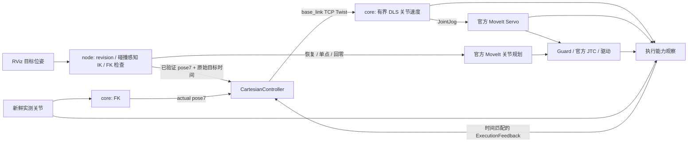

# Servo 控制接口

本页说明 **RViz 鼠标目标跟踪** 的源码接口、控制数学与调参。手柄直接提供速度意图，使用专用 `gamepad_backend.py`，不经过这里的目标追赶控制律。项目总览见 [项目结构与控制接口](项目结构与控制接口.md)，操作步骤见 [RViz 伺服说明](../scripts/task/servo_tracking/README.md)。

随附控制配置当前为 `algorithm: pi`。选择和数值以 [control.yaml](../scripts/task/servo_tracking/config/control.yaml) 为准；本文的 benchmark 是有日期的软件实验记录。

## Servo 的模块边界

| 模块 | 职责与输出 |
| --- | --- |
| [cartesian_control.py](../scripts/task/servo_tracking/cartesian_control.py) | 无 ROS 的笛卡尔控制器；已验证目标与实测 FK → TCP Twist |
| [execution_feedback.py](../scripts/task/servo_tracking/execution_feedback.py) | 无 ROS 的执行能力观察层；对齐请求、DLS 和 Servo/JTC/实测速度，生成抗积分饱和反馈 |
| [ik_selection.py](../scripts/task/servo_tracking/ik_selection.py) | 多种子猜测与合法候选评分；不将种子或预览直接送入控制 |
| [core.py](../scripts/task/servo_tracking/core.py) | URDF FK、雅可比、工作空间、输入/轨迹验证和配置装载 |
| [node.py](../scripts/task/servo_tracking/node.py) | RViz 交互、目标 revision、异步 IK、时间戳、算法调用和任务状态 |
| [guard.py](../scripts/task/servo_tracking/guard.py) | 独立反馈看门狗、控制门、控制权检查、官方指令转发 |
| [joint_motion.py](../scripts/task/servo_tracking/joint_motion.py) | 官方关节规划与 Action；恢复、单点和回零共用身份及停止屏障 |
| [task.launch.py](../scripts/task/servo_tracking/task.launch.py) | 创建专用 MoveIt/Servo/JTC/RViz 栈，实机模式才创建驱动 |
| [rviz_panel/](../scripts/task/servo_tracking/rviz_panel/) | 面板和目标/工作空间显示 |



实机中 FK 来自实机反馈；JTC 的模拟状态用于控制器指令采样。算法模块不读取 CAN、不求解 IK、不生成关节轨迹，也不决定运动许可。它只能接收已验证目标；换算法不能跳过目标、碰撞、反馈、关节限位或控制门检查。

当前 Servo 显式切换为原生 `JOINT_JOG`：`delta_twist_cmds` 保留为请求 TCP 速度诊断，真正控制输入为 `delta_joint_cmds`。官方 Servo 继续碰撞、关节速度/加速度平滑及软限位检查。条件数不再作为启动、恢复或在线减速/停机门槛；DLS 不会使秩亏处不可实现的方向变得可实现，也不保证能从任意关节分支局部到达目标。

## 目标验证与 ROS 接口

所有以下相对名字位于 `/piper_servo` 下；反馈和许可由任务处理，不能用诊断话题代替执行或运动授权。

| 接口 | 类型与用途 |
| --- | --- |
| `target/feedback` | RViz `InteractiveMarkerFeedback`，产生原始完整目标及接收时间 |
| `compute_ik` | 官方 `GetPositionIK`；碰撞感知逆解，返回结果再做硬限位、软余量与 FK 残差检查 |
| `servo_node/delta_twist_cmds` | `TwistStamped`，请求 TCP Twist 诊断；当前不作为原生 Servo 的控制输入 |
| `servo_node/delta_joint_cmds` | `JointJog`，DLS 后的有界关节速度，交给官方 Servo |
| `servo/trajectory` | `JointTrajectory`，官方 Servo 输出；Guard 验证短时轨迹，观察层读取首点 p/v |
| `arm_controller/controller_state` | `JointTrajectoryControllerState`，观察 `.reference` 的 p/v；不作为实机到位证据 |
| `feedback/joint_states` | real 模式原始真实 `JointState`；sim 使用 `commanded_joint_states` |
| `guard/enable` / `guard/hold` | `SetBool` / `Trigger`，独立许可、同步、闭门保持；Backend 不直开驱动门 |
| `guard/plan_joint_target` / `guard/joint_plan_command` | 自定义服务，官方关节规划与计划身份确认/执行/取消 |
| `target_robot_state` / `workspace` | `DisplayRobotState` / `MarkerArray`，目标黄影与绿色范围，仅可视化 |
| `status` | JSON `String`，模式、revision、误差、限速、`antiwindup_state` 与 `execution_feedback` 观察状态 |

目标验证捕获 `(pose, target_time, revision, epoch)` 快照。后续鼠标输入不取消仍在求解的快照；活动伺服允许时限内的旧 revision 作为它自己已验证的跟踪中间目标，最新未检查位姿仍不放行。停止、关节动作或新会话 epoch 隔离迟到结果；失败/过期检查撤销运动。这样在持续 60 Hz 更新、45 ms IK 延迟时不会因“必须等最新 revision”而饥饿，算法仍只接收完整通过检查的目标。

`make_ik_seeds()` 最多给出六个独立数值猜测：严格规划参考、前次预览、`ready_joints`、范围中点及两个腕部翻转猜测。它们不是枚举全部 IK 分支，也不作为运动命令。活动实时跟踪接受第一个完整合法结果以降低等待；未开启跟踪的预览、单点和恢复则收集可用候选，评分为归一化关节位移 RMS + 0.5×最大位移 − 0.15×最小边界余量，兼顾分支连续与边界空间。只有种子可按范围构造，候选解不能裁剪成合法解。

## TCP 速度到关节速度

`core.damped_joint_velocity(q, twist, model, config, scale)` 接收新鲜 q 与上述 TCP Twist，输出六个 rad/s 关节速度。使用旋转长度权重 `L=0.25 m/rad`，`W=diag(1,1,1,L,L,L)`，固定正阻尼 `λ=0.02`：

```text
Jw = W J(q),  vw = W v
qdot = Jwᵀ (Jw Jwᵀ + λ² I)⁻¹ vw
```

实现用 SVD 避免显式求逆；奇异值为零时对应增益为零。逐轴 DLS 上限为 `min(joint_speed, joint_velocity_limits[i]) × speed_scale`；超限时用一个共同因子缩放整组关节速度，保留本次解的关节方向，不生成关节位置插值。`dls_damping`、`dls_rotation_weight` 属于任务 `config.yaml`。`J(q)qdot` 是本次 DLS 可实现速度，可与请求不同；它也是已知上游能力反馈。

## 核心算法输入与输出

用独立控制配置构造 `CartesianController(control_config)`；`control_config` 可取 `load_control_config()` 的结果或任务配置的 `task_config['control']` 字段。随后调用：

```python
twist = controller.update(
    target_pose7, actual_pose7, now, target_time, speed_scale,
    feedforward_active=True,
    execution_feedback=feedback,  # ExecutionFeedback 或 None
    actual_time=feedback_source_stamp,  # 原始实测时间，只用来计算样本间隔
)
```

| 字段 | 含义与约定 |
| --- | --- |
| `target_pose7` | 已验证的 `[x,y,z,qx,qy,qz,qw]`；位置 m、单位四元数，坐标系 `base_link` |
| `actual_pose7` | 原始新鲜关节反馈计算的 TCP FK；格式、坐标系与目标一致 |
| `now` | 当前单调时钟，秒；连续调用必须严格递增 |
| `target_time` | 该目标被接收时的原始单调时间，秒；不能晚于 `now` 或倒退，不能替换成 IK 完成时间 |
| `speed_scale` | `0…1` 的输出上限比例；具体可选档位由操作面板决定 |
| `feedforward_active` | 是否允许目标速度前馈；松手传 `False`，立即清零前馈估计，反馈纠偏继续工作 |
| `execution_feedback` | 可选、已对齐的执行能力反馈；PI 的 `None` 表示未知，不等于未饱和 |
| `actual_time` | 可选，原始实测 FK 对应的源时间（s）；可为 ROS/墙钟，仅同源差分，不与单调 `now` 混算。Node 实际调用始终传入该字段 |
| 返回 `twist` | 六个有限值 `[vx,vy,vz,wx,wy,wz]`；m/s、rad/s；TCP 点处的速度，以 `base_link` 表达 |

同一 `target_time` 不能代表不同位姿；新目标需使用其自己的接收时间。检查中的新目标不会送入算法。调用间隔超过 `max_dt` 时清除旧控制状态，避免跨中断延续积分、微分或前馈。

`reset()` 清除积分、导数滤波、目标速度估计、旧输出与执行反馈匹配历史。Backend 同时重置观察层，在停止、重置/对齐、开始新拖动、目标拒绝、进入关节动作、原生暂停/保持及恢复到运行状态时调用；切换控制方式经停止路径处理。松手使用 `feedforward_active=False`，不把未消除的位置/姿态误差或正常 PI 历史一起清掉。`last_command_time` 与 `last_command_twist` 供执行观察层精确记录该次输出；不由观察层自行发命令。

## 五种控制律

位置误差为 `ep = pd − p`；姿态误差为 `eR = Log(Rd Rᵀ)` 的旋转向量。下表的 `e` 表示两者拼接，位置与姿态使用各自增益。

| 配置值 | 控制律（限幅前） | 特点 |
| --- | --- | --- |
| `p` | `Kp e` | 比例反馈；松手后可叠加实测速度制动 |
| `pi` | `Kp e + Ki ∫e dt` | 本地限幅、执行反馈冻结/回算与积分上限 |
| `pd` | `Kp e + Kd filtered(de/dt)` | 使用滤波后的误差变化率 |
| `feedforward_p` | `filtered(v_target) + Kp e` | FF+P，可选 |
| `feedforward_pd` | `filtered(v_target) + Kp e + Kd filtered(de/dt)` | FF+PD |

姿态差、目标角速度和姿态导数均通过相对旋转计算，不直接对欧拉角差分。前馈使用相邻已验证目标的接收时间估计目标速度；默认滤波时间常数 `0.04 s`，目标不再更新时从 `0.04 s` 开始平滑衰减，到 `0.10 s` 归零；鼠标释放会更早立即关闭前馈。

各算法共用 TCP 平移/旋转范数限幅；可选 TCP 加速度限幅默认关闭，官方关节加速度约束单独生效。`core.tracking_twist()` 保留为旧调用的 P 模式薄包装，实际计算复用此模块；它不是另一份控制算法。

## 松手制动与实测运动状态

当前随附控制配置选择 `pi`，位置和姿态 Kp 均为 2、Ki 均为 0.8。算法与增益以 [control.yaml](../scripts/task/servo_tracking/config/control.yaml) 为准。释放后可共用源时间实测速度制动，其形式为：

```text
v_measured = lowpass((actual_pose[k] - actual_pose[k-1]) / Δactual_time)
u = 原控制律 − w · Kp · T · v_measured
risk_distance = T · ||v_measured|| + tolerance
```

姿态速度使用 `Log(R[k] R[k-1]ᵀ)`，以 base_link 表达。目标位姿的变化不进入实测速度估计；不会因目标跳变产生 D kick。`w` 在线/角块分别计算：朝目标运动时从距目标 `2*risk_distance` 到 `risk_distance` 平滑从 0 增至 1；已经背离目标运动时为 1；低于对应停稳速度容差时不施加阻尼。拖动中 `w=0`，释放后远距离追赶也保持原输出；该项不触发停机、重置目标或关节重规划。

| 参数 | 当前值 / 单位 |
| --- | --- |
| `settling_linear_prediction_time` / `settling_angular_prediction_time` | 0.18 / 0.18 s；设 0 可关闭对应块制动 |
| `measured_velocity_filter_time_constant` | 0.03 s |
| `measured_velocity_timeout` | 0.10 s；同源重复或极小时间推进不会续期 |
| `hold_linear_velocity_tolerance` | 0.003 m/s |
| `hold_angular_velocity_tolerance` | 0.02 rad/s |

`actual_time` 可为源 ROS 时间，`now` 为单调时间。只用前者样本间差估速，后者统计新样本的接收年龄；不能将两种时钟直接相减。源时间倒退、大间隔、reset 或无显式源时间时不沿用旧速度；制动失去估速时回到基本控制律。Backend 的原始新鲜反馈检查独立工作。保持动作要求 `controller.motion_settled` 和原位姿/关节稳定窗口都通过；仅经过位姿容差但仍在运动时不会立即保持。

状态字段新增 `settling_braking`、`measured_tcp_linear_speed_mps` 和 `measured_tcp_angular_speed_radps`。这些是模型 FK 反馈估计，不是外部计量。

已完整删除 `max_joint_tracking_error` 停机规则及其故障快照分支。旧配置字段会被装载器忽略，不换成新误差门槛或持续时间退出规则。关节命令位置、速度、碰撞及真实反馈有效性检查仍使用原链路。

## 执行反馈与 PI 抗积分饱和

`pi` 使用以下执行反馈抗饱和规则。`p`、`pd`、`feedforward_p` 和 `feedforward_pd` 不含积分。`ExecutionFeedback` 是不可变数据类：

| 字段 | 约定 |
| --- | --- |
| `stamp` | 执行端收到该反馈的单调时间；必须新鲜，不使用 ROS 时间冒充同一时钟 |
| `command_time` | 对应控制器原输出 `now`，允许变动的执行延迟；必须匹配仍在历史内的命令 |
| `requested_twist` | 当时完整六维请求，必须与命令历史一致 |
| `limited` | `(linear_limited, angular_limited)`，显式分块标记；测得速度滞后本身不够 |
| `effective_twist` | 可选，同请求语义的限幅后速度或已限定能力不足的实测速度 |
| `source` / `valid` | `command` 或 `measured`，及数据是否具备比较资格 |

源新鲜度默认 `execution_feedback_timeout=0.10 s`，历史匹配允许 `execution_command_timeout=0.50 s` 的请求到执行延迟。未来、倒序、跨 reset、过期、未匹配或格式错误的反馈不能授权新积分。未知时冻结新积分，但允许已有积分沿误差反向退回零；不能将 `None` 当未饱和而继续积累。

本地 TCP 速度/可选加速度限幅仍使用条件积分。下游 `limited=False` 且有效时可正常积分，不能因自然的有限响应速度就阻断。`limited=True` 时阻断推动限幅方向的误差积分；有效速度已知时回算量为：

```text
ΔI = (1 − exp(−dt / τaw)) (u_effective − u_requested) / Ki
```

默认 `antiwindup_mode=clamped_tracking` 只用该量消去限幅方向已有积分，不越过零制造反向 I；误差确已反向时仍允许正常消退与符号转换。可选 `tracking` 为标准不截零回算，可能形成与比例项相反的积分偏置。`Ki=0` 的块不积分、不做除法；线速度/角速度分别判断与限范数，到位分别清零。停止/reset 则全部清零。

`execution_feedback.py` 读取三层执行观测：官方 Servo 轨迹、JTC reference、真实 q。前两层由 `J(q)qdot` 投影；真实 q 用 2–100 ms 新样本差分和中点雅可比估速，不裁剪原始反馈。ROS 源时间戳须新鲜并推进，重复旧样本不续命，命令匹配使用单调接收时间。

DLS 请求与已实现速度直接对应，因此已知损失可立即反馈；未确认的另一块只冻结，不虚构残差。下游能力观察则要求三层新鲜、请求/映射速度稳定、方向一致，持续降速且每层至少三个新样本后才确认，参数如下。

| 参数 | 默认值与用途 |
| --- | --- |
| `observer_stable_window` | `0.16 s`，覆盖当前设计延迟预算的稳定请求窗口；不得小于反馈新鲜度 |
| `observer_saturation_window` | `0.08 s`，持续能力不足窗口；不得大于反馈新鲜度 |
| `observer_linear_noise` / `observer_angular_noise` | `0.005 m/s` / `0.025 rad/s` 的绝对判断余量 |
| `observer_relative_noise` | `0.10`，附加相对速度余量 |
| `antiwindup_tracking_time_constant` | `0.20 s`，回算时间常数 |
| `integral_position_limit` / `integral_orientation_limit` | `0.05 m·s` / `0.20 rad·s`，积分状态范数上限；默认 Ki=0.8 时贡献最多 `0.04 m/s` / `0.16 rad/s`，仍受最终输出限幅 |

稳定请求下观察资格约需 `0.16+0.08=0.24 s` 或更久，30 Hz 源的三个样本可能再多等一帧。持续手拖变速、换向、数据不全或噪声过大时反馈保持未知，PI 冻结新积分。稳定窗只是配置的采样/延迟预算；更长的未建模执行延迟仍可能与真正能力不足混淆。本层不是电机电流/力矩观测器，不证明固件或硬件已经饱和，也不改变 Guard 的运动许可。

## 参数分层与路径优先级

| 参数文件 | 管理内容 |
| --- | --- |
| [Servo config/config.yaml](../scripts/task/servo_tracking/config/config.yaml) | 硬件连接、TCP、DLS、反馈/心跳、关节速度/加速度、保持、规划、IK 参考和工作空间 |
| [Servo config/control.yaml](../scripts/task/servo_tracking/config/control.yaml) | 算法选择、独立增益、TCP 速度/容差、滤波、积分/回算、执行观察和可选 TCP 加速度 |
| [config/baseline.json](../config/baseline.json) | 项目官方驱动基线；不由算法配置改写 |

`core.load_config(task_path, control_path=None)` 的选择顺序：

1. 显式 `control_path`；CLI 对应 `--control-config`。
2. 主任务 YAML 的 `control_config` 字段。
3. 主任务 YAML 相邻的 `control.yaml`。
4. 模块默认 `config/control.yaml`，用于缺少相邻文件的临时旧配置。

CLI 的相对路径以调用目录为基准；YAML 的 `control_config` 以及直接传给 `load_config` 的相对控制路径，以主任务 YAML 所在目录为基准。找不到所选文件会报错。算法名、字段名、数值和各算法增益均验证，不接受拼错字段、NaN 或无效数值。

未显式选择控制文件时，旧任务 YAML 中的 `linear_speed`、`angular_speed`、`position_tolerance`、`orientation_tolerance`、`position_gain`、`orientation_gain` 仍可覆盖对应独立配置，增益覆盖当前算法；非法旧值也会被拒绝。显式控制文件优先于这些旧字段。装载结果包含完整 `control` 和绝对源路径 `control_config`；launch 必要时生成合并后的临时快照传给各节点，日志分别标明源文件与有效快照。

## 调参与公平对照

在项目根目录复制变体，避免混淆硬件/任务参数和算法参数：

```bash
cp scripts/task/servo_tracking/config/config.yaml scripts/task/servo_tracking/config/task_tune.yaml
cp scripts/task/servo_tracking/config/control.yaml scripts/task/servo_tracking/config/control_p4.yaml
```

在 `control_p4.yaml` 将 `algorithm` 改为 `p`，把 `gains.p.position_gain` 与 `gains.p.orientation_gain` 改为 `4.0`。这样与 FF+P 预设的比例增益相同，比较时只改变前馈项；直接使用 P 预设的 `2.0` 会同时改变增益。

```yaml
algorithm: p
gains:
  p: {position_gain: 4.0, orientation_gain: 4.0}
```

其余字段保留复制值，然后运行纯仿真：

```bash
bash scripts/piperl/run.sh python scripts/task/servo_tracking/run.py --mode sim \
  --config scripts/task/servo_tracking/config/task_tune.yaml \
  --control-config scripts/task/servo_tracking/config/control_p4.yaml
```

也可在 `task_tune.yaml` 中写 `control_config: control_p4.yaml`。各算法的增益放在各自 `gains.<算法名>` 下；调整 P 不会改动 FF+P 的参数。修改文件后重新启动任务，当前不热加载算法。

## 软件对比的适用范围

2026-11-14 的纯数学 benchmark 使用理想 TCP 速度对象，包含设定的传输延迟、速度惯性和目标验证延迟，不包含关节几何、奇异性、碰撞、CAN、噪声或固件动力学。它用于比较算法、释放门控和抗饱和策略，不能代表实机精度、延迟或平顺性。

同增益对照、释放超调和抗饱和案例的具体数值保留在 [Servo 历史验证](history/servo_tracking/2026-11-17-validation-history.md)，不在当前操作页重复。历史报告当时选择的算法不决定当前配置；当前随附文件为 `pi`。

复现入口为 [servo_control_benchmark.py](../tests/servo_control_benchmark.py)。报告是本机生成物，不随源码克隆分发。运行条件和当前检查状态见 [测试目录](../tests/README.md)与 [Servo 验证矩阵](../scripts/task/servo_tracking/VALIDATION.md)。
