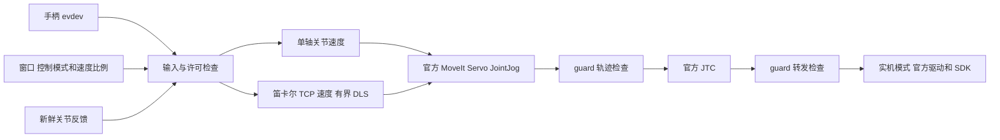

# 项目结构与控制接口

本页说明目录、控制入口、配置与进程所有权。操作入口见 [文档目录](README.md)，鼠标目标控制的公式和源码接口见 [Servo 控制接口](Servo控制接口.md)。

## 目录职责

```text
PiperL_Robot/
├── config/                         官方来源、环境和驱动基线
├── docs/                           操作索引、环境、架构和历史
├── external/                       官方 SDK 子模块与 wheel 缓存
├── piperl_ws/
│   ├── src/agx_arm_ros/              官方 ROS 2、模型及内部子模块
│   └── build/ install/ log/          colcon 生成结果
├── .venv-piperl/                    项目 Python 环境
├── .deps/                          按需准备的 Servo 与标定依赖
├── scripts/
│   ├── piperl/                     环境、构建和官方启动包装
│   ├── task/
│   │   ├── common/                 配置、反馈、场景、规划和进程管理
│   │   ├── single_point/           官方单点规划操作说明
│   │   ├── multi_point/            多点持续会话与 RViz 面板
│   │   ├── obstacle_avoidance/     路径对比、场景编辑和执行
│   │   └── servo_tracking/         鼠标/手柄后端、Servo、guard 和 JTC
│   └── tools/
│       ├── control_panel/          CAN 连接、使能、回零、重置和阻尼急停
│       ├── gamepad_control/        手柄输入、窗口、配置和启动监护
│       ├── monitoring/             被动监控、点位保存和只读诊断
│       ├── handeye_calibration/    D405 检测与标定采样
│       └── maintenance/            只读文档审计
├── tests/                          离线回归与隔离集成验证
└── outputs/                        本机日志、点位和验证产物
```

官方依赖由 [source_versions.json](../config/source_versions.json) 与子模块指针锁定。项目扩展放在 `scripts/`，工具与任务遵循 [scripts/AGENTS.md](../scripts/AGENTS.md)。

## 硬件操作与运动会话

[控制面板](../scripts/tools/control_panel/README.md) 直接使用 SocketCAN，提供 CAN 连接、机械臂使能、机械臂回零、重置、阻尼急停。“CAN 已连接”表示接口和 socket 可用，使能和回零各自读取必要的控制器状态，连接提示不等于运动就绪。

先结束旧控制程序，经面板连接并确认使能，再启动实机控制栈。官方驱动关闭自动使能时在启动阶段读取使能状态；之后由外部面板使能，不能假定其缓存同步更新。急停恢复先结束旧会话与驱动，再面板重置、使能，最后重启控制。

面板可以保留用于阻尼急停。运动会话中不使用面板回零或重置，面板不协调其他 CAN 发送方。关闭面板只关闭自己的 socket，不关闭系统 CAN，也不使电机失能。回零不是手柄启动必需步骤。

手柄窗口和 guard 管理会话许可、轨迹保持与停稳观察，不替代硬件操作。LB/B 软件停止、面板阻尼急停和现场物理急停是不同的停止手段。

## 手柄两种控制模式

运行环境 `demo/input/sim/real` 决定连接范围；控制模式 `single_axis/cartesian` 决定输入映射。两者独立，控制模式在同一窗口内切换。

- `single_axis` 默认 J1，左摇杆上下只产生选定关节的正负速度。LB/B/Y 释放、摇杆中立并停稳时，方向键左右每次按下选择上一或下一轴，到 J1/J6 不循环。其他轴不产生运动。
- `cartesian` 请求 `base_link` 下 TCP 平移与角速度，经模型雅可比的有界 DLS 转为关节速度。旋转中心为 TCP，旋转轴沿基座轴；界面 RPY 是绝对当前姿态显示，不是角度目标。

两模式各自保存本次速度比例，默认 20%。切换要求释放 LB/B/Y、中立、停稳，清除旧输入与滤波历史后重新按下 LB。B 锁定不能靠切模式解除。映射、软件上限和限位退回行为集中在 [手柄参考](../scripts/tools/gamepad_control/REFERENCE.md)。

手柄会话内，摇杆回中并停稳后，持续按住 LB + Y 1 秒请求回零，全程保持两键。回零由现有 MoveIt 关节规划与 guard 执行，目标为六轴零角、独立规划比例 10%；松开任一键或偏转输入取消，B 或异常锁定。它不修改零点标定、不自动使能，也不调用控制面板的 CAN 回零；当前新增入口的验收进度见 [手柄验证矩阵](../scripts/tools/gamepad_control/VALIDATION.md)。



`sim` 使用 FakeSystem，不创建 SDK/CAN 实机驱动。实机 FK、位置和停稳判断必须来自 `feedback/joint_states`，不能用 JTC 的 `commanded_joint_states` 代替。

## 鼠标与规划任务

RViz 鼠标后端 `node.py` 对完整位姿目标做碰撞感知 IK、关节范围和 FK 残差检查，再把已验证目标送入 `CartesianController`。其 TCP Twist 经同一 DLS、Servo、guard、JTC 与官方驱动链执行，另有官方关节规划、保持与恢复。

[control.yaml](../scripts/task/servo_tracking/config/control.yaml) 当前选择 `pi`。手柄直接请求速度，不经过该目标追赶控制律，也不受 `algorithm` 选择影响。专用栈同一时刻只选鼠标或手柄后端。

多点与避障复用 `common`，经官方 MoveIt 规划及官方 Action 执行，不使用手柄速度状态机。起点、模型、目标或场景变化后需要重新规划，轨迹动画与 Action 成功不能代替实测到位。

## 关键模块

| 模块 | 职责 |
| --- | --- |
| [gamepad run.py](../scripts/tools/gamepad_control/run.py)、[stack_supervisor.py](../scripts/tools/gamepad_control/stack_supervisor.py) | 模式、预检、窗口、后台栈和本次进程组回收 |
| [input_adapter.py](../scripts/tools/gamepad_control/input_adapter.py)、[ros_input.py](../scripts/tools/gamepad_control/ros_input.py) | evdev 发现、设备身份、读取与 ROS 输入 |
| [app.py](../scripts/tools/gamepad_control/app.py)、[ros_bridge.py](../scripts/tools/gamepad_control/ros_bridge.py) | 同一窗口、反馈、心跳和会话请求 |
| [gamepad_backend.py](../scripts/task/servo_tracking/gamepad_backend.py) | 两模式速度请求、许可、切换和停止 |
| [node.py](../scripts/task/servo_tracking/node.py)、[cartesian_control.py](../scripts/task/servo_tracking/cartesian_control.py) | 鼠标目标验证与控制数学 |
| [core.py](../scripts/task/servo_tracking/core.py) | FK、雅可比、DLS、模型/反馈/轨迹校验和配置 |
| [guard.py](../scripts/task/servo_tracking/guard.py)、[stop_observer.py](../scripts/task/servo_tracking/stop_observer.py) | 独立许可、指令检查和新鲜反馈停稳观察 |
| [joint_motion.py](../scripts/task/servo_tracking/joint_motion.py) | 官方关节规划、执行身份、取消与交接 |
| [task.launch.py](../scripts/task/servo_tracking/task.launch.py) | 模型、后端、Servo、guard、JTC、可视化及可选实机驱动 |
| [common](../scripts/task/common/README.md) | 多点/避障的共享接口与生命周期 |

## 参数分层与路径优先级

| 文件 | 管理内容 |
| --- | --- |
| [baseline.json](../config/baseline.json) | 官方启动包装器的型号、CAN、末端与驱动基线 |
| [手柄 config.yaml](../scripts/tools/gamepad_control/config/config.yaml) | 手柄软件速度、响应、比例和超时 |
| [手柄 profile](../scripts/tools/gamepad_control/config/flydigi_direwolf2.yaml) | evdev 轴、按键和符号映射，需用实体设备核对 |
| [Servo config.yaml](../scripts/task/servo_tracking/config/config.yaml) | 专用栈 TCP、DLS、关节约束、反馈与规划 |
| [Servo control.yaml](../scripts/task/servo_tracking/config/control.yaml) | 鼠标算法、增益、TCP 约束、滤波与抗饱和 |
| 各任务 `config/config.yaml`、`scene.yaml` | 点位、规划缩放、到位要求与障碍物 |

手柄与任务约束合并为有效配置，下游模型及 guard 独立检查。速度比例不能覆盖模型或各轴约束，通用模型中的 `5 rad/s` 不代表 PiPER-L 实测能力。本页不重复各任务数值，见对应参考和配置。

鼠标控制文件的选择顺序、路径与旧字段兼容关系见 [Servo 参数路径](Servo控制接口.md#参数分层与路径优先级)。

## 核心算法输入与输出

鼠标的 `CartesianController.update()`、`ExecutionFeedback`、五种控制律、松手制动、reset 和软件对照集中在 [Servo 控制接口](Servo控制接口.md#核心算法输入与输出)。有界 DLS 是共用速度映射，不生成关节位置插值，也不决定硬件使能。

## 控制权、退出与运行产物

同一实体机械臂只运行一套运动控制栈。Domain 只隔离 ROS 发现，不隔离 CAN。手柄入口请求停止并清理自己创建的窗口和后台进程组，不按模糊进程名结束其他任务；进程回收报告也不等于实机停稳确认。

| 本机目录 | 内容 |
| --- | --- |
| `outputs/gamepad_control/` | 启动日志、进程身份、清理报告和界面预览 |
| `outputs/servo_tracking/` | 鼠标 Servo 日志与软件对比 |
| `outputs/tasks/<任务名>/` | 配置、规划、场景与执行结果 |
| `outputs/points/`、`outputs/joint_ranges/` | 点位和观察范围 |

生成物不随源码克隆分发。[手柄](../scripts/tools/gamepad_control/VALIDATION.md)与 [Servo](../scripts/task/servo_tracking/VALIDATION.md)验证矩阵分别列当前检查和历史索引，不把旧配置的仿真结果视为当前实机验收。
