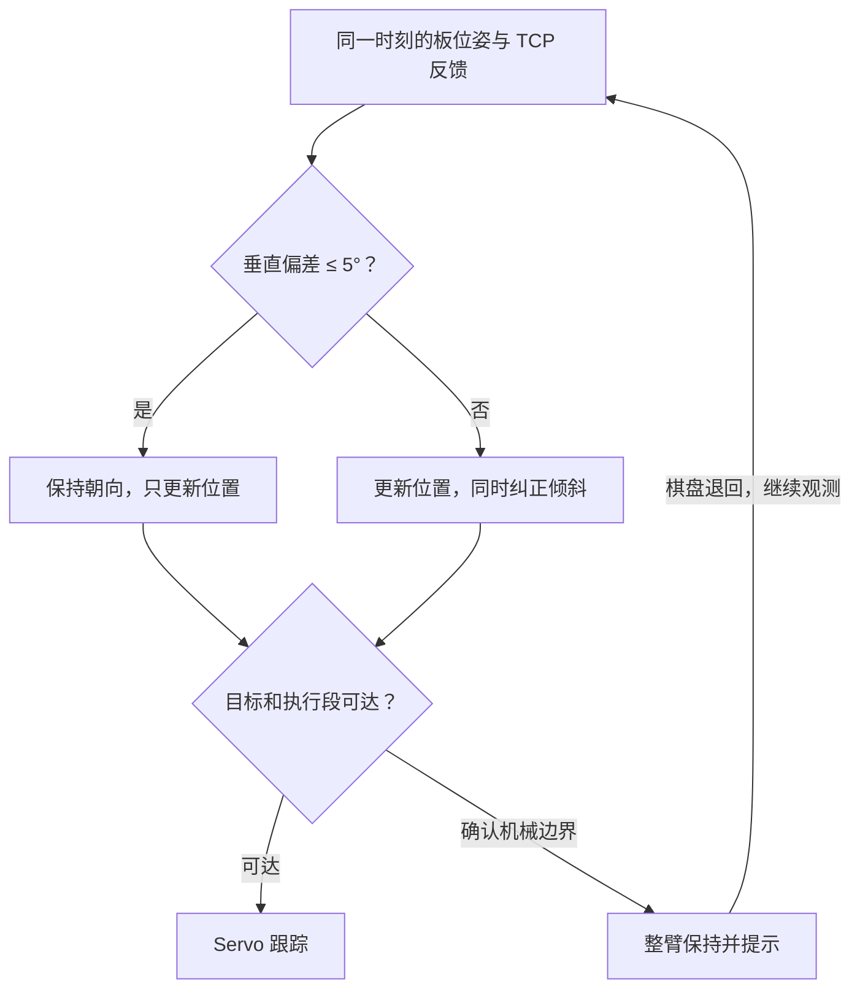

# PiPER-L 棋盘格定距位置跟踪与姿态容差控制

2026-11-19 · 已实现的开发规格与验收标准 · 现有工程参考版本 `f1f52a8`

实现和运行命令见[任务首页](README.md)。验收状态见[实测记录](../../../outputs/tasks/visual_servo/VALIDATION.md)。

## 1. 操作者应看到什么

PiPER-L 跟随手持棋盘中心移动，使图案中心位于 **TCP +Z 正前方**，目标距离由 `distance_m` 设置。姿态要求为与板面垂直方向相差最多 **5°**，即 **85°～95°，含两端**。板面内滚转不会单独触发纠倾。

| 操作者的动作 | 机械臂的行为 |
| --- | --- |
| 横移棋盘，或使棋盘靠近、远离镜头，垂直偏差始终为 3° | 只平移跟随中心并保持距离。腕部保持已有朝向，不追求把 3° 压到 0° |
| 在一个倾斜平面内从 87° 缓慢变到 95° | 全程只跟位置。恰好 85°、90°、95° 均属于位置跟踪区 |
| 棋盘继续倾到 97°，或往另一侧倾到 83° | 垂直偏差为 7°。位置跟踪继续，同时平滑纠正倾斜。实测偏差回到 5° 以内即结束视觉姿态纠偏，继续只跟位置 |
| 保持棋盘中心和法线不动，像转方向盘一样转动棋盘 | 居中、距离已满足时，末端保持。系统不指令腕部跟随棋盘格边缘滚转 |
| 持板移向工作空间边缘或完整目标进入关节保护区 | 机械臂沿验证通过的接近点朝目标移动，按剩余制动距离减速。无法继续推进时保持，提示实际到达的边界或目标暂不可达 |

**验收时看两个动作。** 偏差从 4° 增至 7°，运行面板应从“位置跟踪”切换为“位置跟踪 · 姿态纠偏”，运动许可保持。若在这时到达关节软限，面板才显示对应的机械边界和退回提示。人工停止、数据失效和设备故障沿用独立的停止路径。

## 2. 可复用的工程接口

| 已有模块或数据 | 当前行为 | 本任务如何使用 |
| --- | --- | --- |
| [棋盘格检测器](../../../scripts/tools/handeye_calibration/chessboard.py) | 同时间戳的彩色图与 CameraInfo，经角点检测和 PnP 得到板位姿，正深度和重投影 RMS ≤ 1 px 才发布，跟踪模式从同帧设备与主机内核元数据估计曝光时刻，标定模式沿用图像头 | 订阅已有位姿及同源的缺板曝光通知。预览叠图中的 RMS 目前没有独立的数值话题 |
| [检测配置](../../../scripts/tools/handeye_calibration/config/config.yaml) 和 [检测入口](../../../scripts/tools/handeye_calibration/cli.py) | 默认 8 × 11 内角点，格长 15 mm。棋盘格模式的话题固定为 `/handeye/chessboard/pose` 和 `/handeye/chessboard/result` | 启动时读取检测所用的同一份规格计算中心。使用 `marker` 子命令开展动态识别，手眼采样的停稳窗口只用于标定 |
| [手眼结果说明](../../../scripts/tools/handeye_calibration/README.md) 和 [变换校验、插值](../../../scripts/tools/handeye_calibration/quality.py) | `T_end_camera.json` 存 4 × 4 数组，`session.json` 记录坐标系和方向。已有 `checked_transform`、`interpolate_transform` | 复用几何验证与插值。随运行记录所用文件、哈希、frame、棋盘尺寸和 TCP 设置 |
| [运动学模型](../../../scripts/task/servo_tracking/core.py) 和 [Servo 后端](../../../scripts/task/servo_tracking/node.py) | `RobotModel.pose(q)` 给出 `base_link` 中的 `tcp_link`。后端用反馈 FK、带碰撞检查的 IK、目标版本和会话编号管理运动 | 视觉输入提交完整 TCP 候选位姿。复用现有验证、控制器、DLS 与 Guard |
| [Servo 启动器](../../../scripts/task/servo_tracking/run.py)、[launch](../../../scripts/task/servo_tracking/task.launch.py) 和 [控制接口](../../../docs/Servo控制接口.md) | 后端当前由 RViz 交互目标驱动，经 MoveIt Servo 的 JointJog、官方 JTC、Guard 和驱动执行。启动器管理模式、锁、心跳和清理 | 在同一套执行栈内加入视觉目标来源，保留实机面板心跳、控制权互斥和停止路径 |

**本机可供复核的标定结果。** `outputs/handeye/20261118_124304_059892_combined/` 内包含 `T_end_camera.json`、`session.json` 和 `REPORT.md`。报告给出的方向为 `tcp_link_T_handeye_d405_color_optical_frame`，平移单位为米。58 个样本全部参与拟合，两个固定板位置组的位置 RMS 散布分别为 9.88 mm 和 11.96 mm。独立绝对精度仍待测量。该目录属于本机运行输出，新克隆的仓库可能缺少这些文件。实机通过参数显式选择与当前支架、零 TCP 偏移和相机匹配的结果目录。缺文件时报告路径并保留只读预览能力。仿真用版本化测试外参，可在全新检出中运行。

## 3. 位姿几何与控制目标

记 `B = base_link`、`E = tcp_link`、`C = handeye_d405_color_optical_frame`、`G = 棋盘格坐标系`。用 `T_BE` 表示从 E 系到 B 系的刚体变换，其他下标遵循相同顺序。相机光学坐标 x 向画面右侧、y 向下、z 向前。内部长度用米，姿态消息用 xyzw 四元数。[ROS REP 103](https://github.com/ros-infrastructure/rep/blob/master/rep-0103.rst)

1. **把测量原点移到图案中心。** 定义中心坐标系 H，轴向与检测器的棋盘系 G 相同。令 `T_GH = [I, g]`，其中 `g = [(n_x−1)s/2, (n_y−1)s/2, 0]`。默认 8 × 11 个内角点、格长 15 mm，得到 `g = [0.0525, 0.0750, 0] m`。
2. **在基座系重建运动。** 以检测消息的图像采集时间 `t` 插值 TCP 反馈。计算 `T_BC(t) = T_BE(t) · T_EC`、`T_CH(t) = T_CG(t) · T_GH`、`T_BH(t) = T_BC(t) · T_CH(t)`。后者同时给出棋盘中心 `p_BH` 和完整朝向 `R_BH`。固定棋盘、移动机械臂时，基座系中的板中心与朝向均应近似不变。
3. **测量工具轴与板法线。** 令 `a = R_BE(t) · [0,0,1]ᵀ` 为实测 TCP +Z，`n = σ · R_BH(t) · [0,0,1]ᵀ` 为板面的有向单位法线，二者均在基座系表示。默认约定 +Z 朝向板面。启动预览时，取使 `n · (p_BH − p_BC) > 0` 的符号 σ，并在识别同一实体板面期间固定。显示工具轴箭头与法线箭头供现场核对。识别翻转、侧别不明时丢弃观测，禁止逐帧改符号制造较小误差。当工具 +Z 与所选法线相反时，偏差应为 180°。

   ```text
   α = atan2(norm(cross(a, n)), dot(a, n))      # 两个单位向量的夹角，内部用弧度
   τ = radians(5)
   α ≤ τ    位置跟踪，保持末端朝向
   α > τ    位置跟踪，同时纠正倾斜
   ```

   “85°～95°”描述从垂直方向向两侧倾斜的容差。在单个倾斜截面中，这两侧分别表现为小于或大于 90°。三维控制直接计算 **+Z 相对有向法线的无符号偏差 α**。横向和纵向倾斜组合后仍用这一角度。只有相机时，可将工具轴改用 `R_ECᵀ · [0,0,1]ᵀ` 表达到相机系，与 `σ · R_CH · [0,0,1]ᵀ` 在同一坐标系求角。比较等号时只给浮点舍入留数值精度。
4. **容差内只生成位置变化。** 初次进入位置跟踪，用新鲜实测 TCP 朝向锁存 `R_hold`。后续有效帧保持同一 `R_BE_cmd = R_hold`，只更新位置部分。底层伺服继续维持这个朝向以抵抗扰动。视觉层的姿态增量为零。棋盘绕法线转动不更新 `R_hold`。无需指定与板边的滚转角。
5. **容差外只增加必要的倾斜修正。** 位置任务保持有效。用 `k = normalize(a × n)` 作为基座系旋转轴，从当前实测朝向构造 `R_BE_cmd = Rot(k, δ) · R_BE_actual`。选择朝法线方向的小转动，让夹角减小，应用视觉模式的角速度限制。一个可实现的参考取法是让目标落在 5° 带内少许，给有限精度控制留收敛余量。物理反馈一回到带内即撤销剩余纠偏。旋转轴与工具 +Z 垂直，因此不额外指令绕自身 +Z 拧腕。实际起步与过渡段允许 α 仍大于 5°，只要方向能减小偏差且运动学检查通过。避免把“当前尚需纠偏”写成 IK 或开门的拒绝条件。
6. **纠偏结束时立即更新姿态目标。** 首个有效的带内实测观测到达后，结束旧纠偏版本，清理视觉旋转积分、角前馈和排队的旧姿态指令，用当时新鲜的反馈朝向重新锁存 `R_hold`。旧 IK 回调不得让末端继续向 0° 追赶。保留平移目标与其控制状态，必要的受限减速由执行层完成。若点击开始时 α 已为 7° 且观测可信、目标可达，可直接开始主动纠偏。非法四元数、异常翻面或近反向造成的修正方向不可靠按输入质量规则处理。
7. **同时满足中心与距离。** 对位置跟踪和姿态纠偏都使用该周期选定的 `R_BE_cmd`。棋盘中心取在 TCP 的 +Z 射线上。

   ```text
   p_BE_cmd = p_BH − d · R_BE_cmd[:,2]
   ```

   用目标 TCP 反算，理想棋盘中心在工具系应为 `[0, 0, d]`。面板报告实测 TCP 到中心的直线距离、TCP 系横向偏移和实测 α。

**工具外侧的轴向依据。** 此任务以 `piper_l`、`effector_type=none` 和零 TCP 偏移加载模型。MoveIt 的 `tcp_joint` 将 `tcp_link` 固定在法兰 `link6` 上，两者轴向一致。PiPER-L 的 `joint6` 原点相对 `link5` 位于 `(0, −0.091, 0) m`，绕 X 旋转约 +90°，因此 `link6` 的 +Z 指向从腕部到法兰的外侧。同型号的官方夹爪装配也沿法兰 +Z 将夹爪基座向外平移 4.5 mm。这里选定 `tcp_link` 自身的 **+Z**（蓝色轴）。[任务启动参数](../../../scripts/task/servo_tracking/task.launch.py) · [TCP 固定关节](../../../piperl_ws/src/agx_arm_ros/src/agx_arm_moveit/config/agx_arm.urdf.xacro) · [PiPER-L 裸臂 URDF](../../../piperl_ws/src/agx_arm_ros/src/agx_arm_description/agx_arm_urdf/piper_l/urdf/piper_l_description.urdf) · [官方夹爪装配](../../../piperl_ws/src/agx_arm_ros/src/agx_arm_description/agx_arm_urdf/piper_l/urdf/piper_l_with_gripper_description.xacro)

**D405 的定距与工具轴的垂直度。** 本机联合标定的相机光轴在 TCP 系下约为 `[0.3222, −0.0155, 0.9466]`，距 TCP +Z 约 **18.82°**。所以镜头正对板面时，若外参与本机安装一致，TCP 的垂直偏差约为 18.82°，应进入姿态纠偏。反过来，当工具轴正对板面时，D405 应以约 18.82° 斜视棋盘，图案在画面内可以偏离主点。调试时分别观察这两种量，并复核 35 cm 附近整板可见。[本机联合标定报告](../../../outputs/handeye/20261118_124304_059892_combined/REPORT.md)

## 4. 数据、控制状态与接入方式



| 输入或状态 | 契约 |
| --- | --- |
| 棋盘位姿 | `/handeye/chessboard/pose`，`geometry_msgs/msg/PoseStamped`，彩色 optical frame，图像采集时间。检测到错误 frame、非有限数、无效四元数或中心深度 ≤ 0 时拒绝该帧并记录原因 |
| 机器人位姿历史 | 实机从 `/piper_servo/feedback/joint_states` 取具名六轴反馈，仿真用 `/piper_servo/commanded_joint_states` 的模拟反馈。与后端共用模型和关节顺序，对各有效样本做 FK，再按图像时间线性插值平移、SLERP 插值旋转。实机初次接入用同姿态的官方 `/piper_servo/feedback/tcp_pose` 对照模型 TCP 定义。如发现系统性差异，先检查模型、零位和 TCP 偏移 |
| 图像时间与反馈时间 | 源时间在同一 ROS 时钟域内比较。允许在有限缓存中等待图像时刻之后的反馈，超过等待预算后丢帧。禁止外推或用回调时刻的最新姿态补齐。同时间戳重复帧仅消费一次。乱序或跨时钟重置的旧帧无法续期 |
| 接收、验证与超时 | 本地单调时钟记录原始接收时刻，供看门狗、IK 快照和控制器使用。源时间戳贯穿到目标验证完成。等插值、等 IK、重新发布、面板心跳都不能刷新原始观测年龄。实时追踪检查目标曝光与逆解有效期。固定目标续行检查相同目标版本、同源缺板曝光与反馈时效 |
| 视觉与运动的接口 | 棋盘入口将 PnP 位姿转换为 `CameraTarget(center, direction, two_sided=True)`。球心可传 `CameraTarget(center)`，可信的花苞接近方向可传 `CameraTarget(center, direction)`，方向按期望 TCP +Z 定义。`Observations.receive_target` 接收光学 frame、采集时间、观测、当前 ROS 时间和单调接收时间。匹配曝光时刻后由 `TargetGeometry.measure` 生成 TCP 候选，再进入共享 IK、笛卡尔控制器、DLS 和 Guard。替换 ROS 检测器时同步配置发布者身份、话题及观测解码，保留来源检查 |
| 操作与显示 | 继续使用 `/piper_servo/start`、`/piper_servo/stop` 和现有状态发布。显示位置跟踪或姿态纠偏、实测 α、5° 容差、距离和中心误差。另行显示机械边界、故障原因、Guard 状态和图像年龄 |

建议用两个独立判断管理状态。**运动许可**负责预览、可运行、机械边界保持、人工停止与故障。**姿态控制**仅在运动获准时决定保持朝向或纠正倾斜。跨越 5° 时只切换姿态控制，继续使用当前会话和位置目标。机械边界保持期间仍可更新全部观测与下一候选，但只读预览不能解除 Guard。

复用 `Backend.update_target` 中通用的候选目标更新，以及 `validation_tick`、`ik_done`、`accept_ik` 和现有控制器。带内帧的朝向目标应逐帧一致，切换时通过版本号废弃旧纠偏的异步结果。归零旋转积分时保留平移积分。视觉程序使用只读标记。鼠标拖动、单点与回零等现有控制入口通过原有互斥机制与视觉会话分开。

## 5. 机械边界、退回与提示

启动、远距离追赶和近距离跟踪共用同一个笛卡尔 PI 和 Servo JointJog 通道。新鲜曝光经过手眼变换和碰撞感知 IK 验证后即可用于当前周期，随后到达的新观测继续更新目标。按下开启时目标可以持续移动。目标平移、姿态纠偏和距离变化均在同一次 Guard 许可下处理。

每周期先用阻尼最小二乘把 TCP 速度映射为关节速度。由实测关节角和 Guard 验证的轨迹末点计算每个关节正反方向的余量。余量、制动距离和关节速度共同限制有界最小二乘。已验证分支在软边缘起步时优先向内，候选步骤须推进加权 TCP 目标。纠倾时用手眼外参和内参预测角点余量，必要时先平移。求解后还会用实际雅可比速度复查视野。发送前复查 TCP 速度、工作空间与关节边界。执行使用 MoveIt Servo 的碰撞监测与加速度平滑。Guard 校验 Servo 输出的原始关节位置、速度及相邻点时间，然后向位置控制器转发同一组位置和时刻，由控制器线性插值。

固定目标续行使用实测 TCP 的位置和姿态误差判断进展。两者进入到位容差后按原流程检查停稳。若未到位、关节持续受限且误差在整个观察窗口内缺少有效下降，则请求保持并等待新目标。视觉保持遇到 Guard 已经执行的限位暂停时，复用该次停止编号和停稳确认。

完整视觉目标超出几何范围或找不到合格的逆解时，视觉后端从实测 TCP 沿目标方向生成接近点。接近点在工作空间或腕部范围的边界前缩短，再验证同一关节分支的逆解与碰撞。工作空间减速使用实测 TCP 和 Guard 已验证的轨迹末点计算剩余制动距离。接近无法持续推进时才显示实际到达的边界。仍在可移动范围但找不到下一步时，显示“当前目标暂不可达”。退回后仍依赖 Guard 的停稳确认和新目标验证。

| 情况 | 界面与动作 | 后续行为 |
| --- | --- | --- |
| 正常，α = 3° | “位置跟踪 · 垂直偏差 3°”。只跟位置 | 继续更新棋盘位置和法线 |
| 正常，α = 7° | “位置跟踪 · 姿态纠偏 · 垂直偏差 7°”。末端在跟随中心时主动纠偏 | 进入 5° 容差后恢复“位置跟踪”。这个过程无需保持服务、暂停告警或操作者回退棋盘 |
| 接近工作空间边界、关节软边界后无法继续推进，或无可行的下一步 | 标出实际触发的轴、方向或工作空间面。找不到下一步时提示“当前目标暂不可达”。撤销跟踪输出并请求 Guard 保持 | 保持进程、相机、反馈和停止按钮运行。棋盘移回且最新目标与首段运动可执行时自动恢复 |
| 主动停止、碰撞停机、硬限位异常、设备故障、检测节点掉线或面板失联 | 显示具体原因，撤销相应运动许可，继续显示现场状态 | 原因解除后可预览，由操作者重新开始。按源时间判断识别超时，旧帧无法续期 |

**进入保持。** 在控制循环优先处理工作空间或关节边界事件，发出零运动意图并请求 Guard 走正式暂停、控制器保持和关闭转发路径。清理待执行目标、前馈、积分及异步 IK，保存触发原因和边界处的观测。为这一轮保持分配新的编号，给异步 IK、开门和关门请求绑定对应编号。拒绝迟到结果，阻止准备中或已在途的开门请求在越界后生效。可基于已有 `Backend.reject`、`on_guard` 与 `maybe_resume` 实现，视觉分支应把回退条件接到所有开门路径。连续跟踪进入机械边界保持后，须等待有效退回。Guard 已处于暂停时复用其停止状态，避免持续越界时每帧调用保持服务。[Servo 后端](../../../scripts/task/servo_tracking/node.py) · [独立 Guard](../../../scripts/task/servo_tracking/guard.py)

**边界恢复。** 按本轮 `stop_generation` 检查 Guard 的 `gate_closed`、`stop_settled` 和 `stop_confirmed`。连续 3 个新鲜观测通过目标检查后，Guard 在关闭状态下对齐控制器和重置 Servo。进入 `prepared` 后，从最新的实测关节位置验证经 IK 批准的首段。开门请求带上停止编号、准备编号、首步起点和曝光有效期，Guard 在打开驱动门前复核。真实机械边界要求向内起步。丢板保持后重见棋盘时，可用新帧验证工作空间内的接近点。

**恢复时选择动作。** 新目标验证通过且 Guard 完成开门握手后，根据**当下**的 α 选择位置跟踪或位置跟踪加纠偏。即使 α 仍为 7°，可执行的向内退回与姿态纠偏也允许恢复。首次发送新运动命令前复查停止请求、观测年龄和保持编号。用户主动停止、反馈陈旧、相机失联或故障优先。工作空间和关节报警各记录一次进入和一次恢复，持续留在边缘期间不逐帧刷屏。

### 参数与时间

| 项目 | 设定 | 用途 |
| --- | --- | --- |
| 垂直姿态容差 | **5°，含等号** | 配置项为 `normal_tolerance_deg`。从一次有效观测进入容差即结束旋转纠偏，容差不参与 Guard 暂停和恢复判定 |
| 跟踪距离 | `distance_m` | TCP 原点到棋盘中心的距离，沿工具 +Z |
| 线速度 / 角速度 | 0.30 m/s / 1.50 rad/s | 与共享 Servo 的满量程一致。视觉默认滑块 30%，对应 90 mm/s 和 25.8°/s |
| 最大观测年龄 / 最大反馈插值间隔 | 建议 0.15 s / 0.05 s | 检测与机器人反馈时间匹配。插值不外推，算法和 IK 等待时间计入有效期 |
| 边界退回确认 | 建议连续 3 个有效新帧 | 仅用于机械边界恢复验证。关节软余量沿用原配置，任务工作空间按实机可达范围设置 |

开启跟踪时允许尚无目标，保持 Guard 关闭并等待首帧。每帧以曝光时刻的反馈计算基座系 TCP 目标。检测器对有效图像发布位姿或带原曝光时间的缺板通知。持续收到新鲜缺板通知时，控制器保留最后目标及对应的逆解版本，每拍用实测 FK 计算剩余误差。到位并确认稳定后请求 Guard 保持。途中重见时改跟新验证的目标。单帧时效为 150 ms，重复包、迟帧、错误来源均不能延长固定目标的运动许可。若缺板通知中断则请求保持。其他迟帧和反馈保护沿用现有流程。在保持状态，等 Guard 确认停稳、连续三帧目标有效且退回首步通过检查后恢复。操作者停止时清除目标与待决验证。

每帧先检查原始候选的工作空间与可达边界。连续伺服时对基座系中心按曝光间隔做一阶低通（时间常数 50 ms），工具轴和 5° 分支采用当前测量。匀速上限随滑块缩放；连续伺服的线、角加速度上限分别为 0.20 m/s² 和 40°/s²，同样随滑块缩放。在基座系将棋盘中心、法线和候选 TCP 与上次采用值比较。位置均在 1 mm 内、角度均在 0.35° 内且姿态分支相同，沿用上次的目标和 RViz 标记。任何一项超过门槛即采用新值。原始角度仍决定 5° 分支，原始观测仍用于工作空间核对；新帧保留自己的采集时间和反馈插值。单帧扰动可能改变纠偏需求，不能中断平移或开关运动许可。真实机械边界应结合速度、制动和反馈时延保留停止余量。现场单独测量收到保持请求至反馈停稳的时间和距离。

## 6. 开发顺序与操作入口

| 步骤 | 交付内容 | 验证要点 |
| --- | --- | --- |
| 1. 纯几何 | 在任务 `geometry.py` 中计算棋盘中心、α、最短倾斜修正和定距 TCP 目标 | 等号、两侧倾斜、复合倾斜、纯板面旋转、反向输入和非单位手眼矩阵 |
| 2. 只读预览 | 用 `run.py` 和 `config/config.yaml` 接入相机，显示中心、法线、α 和当前应采取的动作 | 仅使用相机与外参可观察容差切换，接入反馈后显示基座系候选。此模式不控制实机 |
| 3. 视觉目标接入 | 分开保存位置目标、保持朝向、待验证纠偏与运动许可。集成 Servo/Guard，处理机械边界及反向退回 | 容差内跟踪与带外纠偏之间持续平移，旧异步结果不再注入角运动。现有鼠标与手柄入口通过回归 |
| 4. 隔离仿真 | 使用官方 `mock_components/GenericSystem`，由独立板轨迹和模拟反馈生成相机观测。至少一个用例从合成图经过真实棋盘检测器 | 实际模拟关节和反馈 FK 支持第 7 节的行为断言。纯滚转不得驱动拧腕 |
| 5. 现场操作说明 | 更新 README、调试参数、日志路径和现场试验记录 | 将软件回归结果与需要操作者低速验证的项目分开记录 |

以下为实际 CLI 入口。以仓库根目录为工作目录。默认模式为 `sim`，仅显式 `real` 选择硬件执行。提供 `--config` 覆盖任务配置。默认配置路径按脚本位置解析，用户传入的相对路径按工作目录解析。

```bash
bash scripts/piperl/run.sh python scripts/task/visual_servo/run.py --mode observe
bash scripts/piperl/run.sh python scripts/task/visual_servo/run.py --mode sim
bash scripts/piperl/run.sh python scripts/task/visual_servo/run.py --mode real --handeye-dir outputs/handeye/20261118_124304_059892_combined
```

`observe` 仅观察，建议默认接入现有相机检测流，现成启动命令见[任务首页](../../../scripts/task/visual_servo/README.md)。`sim` 默认使用合成观测和测试外参，按场景脚本移动棋盘。实机模式 `real` 仅接受现场相机和官方实测反馈，启动后仍停在预览。从项目入口继承 ROS Domain，沿用原 Servo 的进程锁、CAN 互斥和停止清理。已有明确归属的相机、检测进程可复用。检测到同名位姿话题有多个发布者时，报告冲突并停留在预览。任务不自动使能机械臂。

## 7. 验收场景

| 用例 | 输入 | 应观察到的结果 |
| --- | --- | --- |
| 两侧容差与端点 | 同一截面依次生成 84°、85°、87°、90°、93°、95°、96°，保持位置可达 | 84° 和 96° 对应 α=6°，进入纠偏且方向相反。85°～95° 全部只跟位置，保持朝向目标恒定，视觉角增量为零。全程无机械边界事件或暂停请求 |
| 纠偏时继续移动 | 在可达区把偏差从 3° 增至 8° 并横移棋盘。停住倾斜、继续横移，等待实测偏差回到 5° 以内 | 模拟机械臂持续跟随中心，旋转方向减小 α。进入容差后即锁存此时朝向，后续平移不继续追求 0°。记录纠偏时间、锁存目标、平移输出和反馈 FK |
| 可带外启动 | 开始时观测可信、目标可达但 α=7° | 操作者启动后直接纠偏并跟位置，进入容差后切换为只跟位置 |
| 纯板面滚转 | 中心固定、α=3°，棋盘绕其法线正反旋转 30°。再叠加小幅平移 | 原地转板不产生新姿态目标。叠加平移后只更新位置，检查来自反馈的末端角运动和视觉角命令 |
| 正交方向与组合倾斜 | 分别倾向上、下、左、右，再叠加两项 4° 正交转动使合成法向偏差大于 5° | 依据三维向量夹角进入正确分支。结果与所选坐标系、四元数符号及相对初始板姿态无关 |
| 定距与安装偏移 | 三轴各施加 ±30 mm 阶跃。使用非零相机安装平移与旋转，同步核对几何逆变换 | 理想目标反算中心误差 < 10⁻⁶ m。640 × 480 仿真建议阶跃 4 s 后取 2 s 稳态窗，TCP 距离误差绝对值 P95 ≤ 10 mm、TCP 系横向误差 P95 ≤ 5 mm。边移动边纠偏时同样记录这两项 |
| 时间与识别质量 | 注入延迟、重复、乱序、错 frame、角点翻转及完整遮挡。加入延迟返回的 IK 纠偏结果 | 时间匹配正确，拒绝无效帧。带内锁存的朝向不能被旧纠偏覆盖。空画面开启后原地等待；缺板图像持续到达时完成最后目标，中途或到位后重见均能自动续跟；检测节点掉线须重新开始 |
| 机械边界及反向恢复 | 分别遇到工作空间边界、关节上软限与下软限，再令棋盘回到可行区。分别在 α=3° 和 α=7° 下复测 | 到界整臂停、提示明确、状态与图像持续更新。在同一会话内从实测状态向合法方向恢复。α=7° 的恢复首段允许伴随纠偏。若用户已主动停止则不得自动恢复 |
| 回归与竞争 | 纠偏中或边界保持中测试主动停止、面板失联、迟到的开门回复与其他控制源 | 停止优先，旧目标和回复无法重新产生运动。原鼠标、手柄、手眼离线用例的行为保持可用。[项目验证入口](../../../tests/README.md) |

**验收证据。** 使用独立生成的棋盘真值与机器人反馈重算中心、法线与角误差。单位测试验证带内姿态指令不变，仿真再验证执行运动和停稳。主动纠偏阶段允许有超过 5° 的过渡误差，应报告回到容差所用时间。平移性能同时报告有效观测覆盖率、P95 和最长断流，避免只统计少数成功帧。

**现场顺序。** 先只读预览验证工具轴、两侧 5° 判定、35 cm 取景与时间同步，再用固定板测试低速平移。随后测试轻微倾斜仍只跟位置、较大倾斜主动纠偏、板内旋转时腕部保持。最后验证机械边界停稳、退出边界自动恢复以及手动停止优先。只有物理反馈证实停稳时，界面才显示已停稳。

**日志。** 保存到 `outputs/tasks/visual_servo/<会话>/`。记录有效配置、外参路径与哈希、图像源时间和接收时间、反馈插值间隔、板中心、方向可信度、α、容差分支、保持朝向、候选与已验证 TCP、线/角命令、实测 FK、运动许可、机械边界原因与 Guard 停稳/恢复时间。记录 Servo 日志路径。
